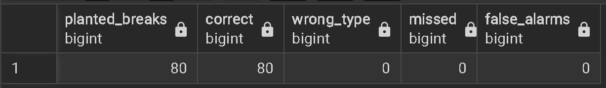
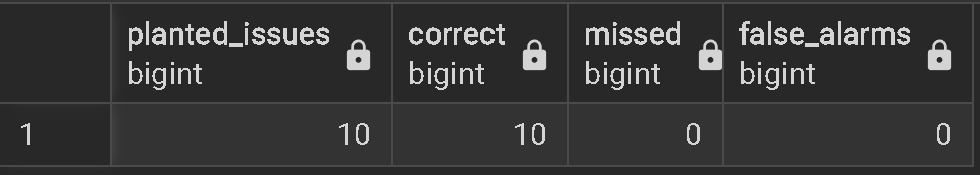
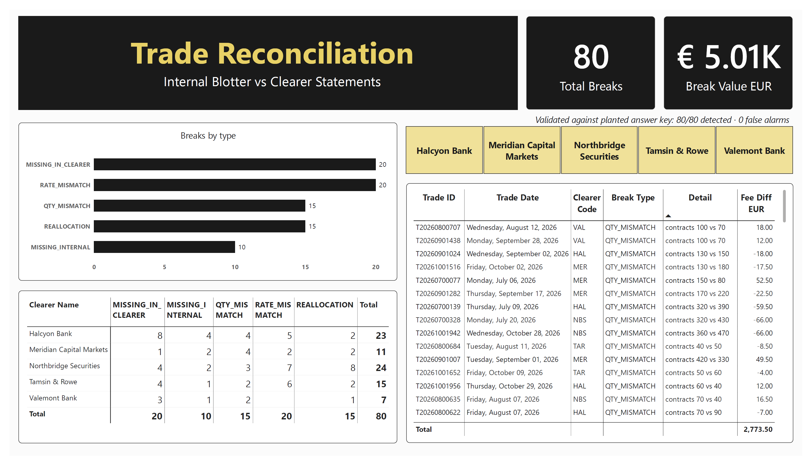
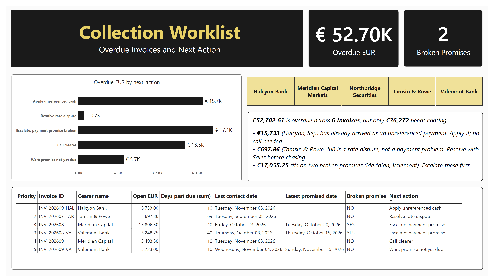

# Derivatives Billing Reconciliation & Receivables

A trading-operations workflow for a broker that earns a fee per contract on exchange-traded futures and options and bills its clearing banks every month. The project reconciles trades against clearer statements, matches cash to invoices, ages the receivables and turns the results into a prioritised collection worklist.

**PostgreSQL · Power BI · Python (pandas)**

## Results

| Check | Result |
|---|---|
| Trade breaks found vs planted answer key | **80 / 80 detected, 0 wrong type, 0 missed, 0 false alarms** |
| Cash issues found vs planted answer key | **10 / 10 detected, 0 missed, 0 false alarms** |




## Key findings (as of 10 Nov 2026)

- **80 trade breaks worth €5,012.50** in absolute fee differences. The largest group is trades billed by us but missing from the clearer statement (€3,123).
- **All 20 rate mismatches go the same way:** the clearer applies a lower rate than ours. This is a rate-schedule issue to resolve with Sales, not 20 separate errors.
- **€52,702.61 is overdue across 6 invoices, but only €36,272 needs chasing.** €15,733 has already arrived from Halcyon Bank as a payment without an invoice reference.
- **Halcyon's DSO of 60 days drops to about 30** once that payment is applied. Without cash matching, a client that pays on time looks like a late payer.
- **Meridian Capital Markets is the real collection case:** DSO of 92 days against 30-day terms, plus a broken payment promise.
- **€697.86 short-paid by Tamsin & Rowe is a rate dispute,** so it goes to Sales / Client Management before any reminder is sent.

## Dashboard

Three Power BI pages. A clearer slicer is synced across all of them. The full report is in [`powerbi/derivatives-billing-recon.pdf`](powerbi/derivatives-billing-recon.pdf).

**1. Trade reconciliation**: breaks by type and clearer, with the detail for each trade


**2. Receivables**: aging heat map by clearer, DSO against the 30-day terms, invoice status


**3. Collection worklist**: overdue invoices with a priority and a next action


## How it works

```
internal_trades ─┐
                 ├─► trade reconciliation ─► v_recon_breaks ─► validated vs answer key
clearer_statement┘
invoices + payments ─► cash reconciliation ─► v_invoice_status ─► unapplied-cash matching
                                                    │
                                                    ├─► v_aging (buckets) ─► v_dso
                                                    │
collection_log ─────────────────────────────────────┴─► v_collection_worklist
                                                              │
                                     Power BI dashboard ◄─────┴─► Python: collection email drafts
```

| Step | File | What it does |
|---|---|---|
| Create tables | `sql/00_create_tables.sql` | Typed tables for trades, statements, invoices, payments, collection log |
| Load data | `sql/01_load_data.sql` | Loads the CSVs with `\copy` and checks the row counts |
| Trade + cash reconciliation | `sql/02_recon.sql` | Full outer join of internal trades vs clearer statement; break classification (missing on either side, quantity, rate, reallocation); invoice payment status; unreferenced-payment matching |
| Receivables | `sql/03_receivables.sql` | Aging buckets, DSO per clearer, collection worklist with priority rules, cash-side validation |
| Export | `sql/04_export_outputs.sql` | Writes the five result views to `output/` |
| Automation | `notebooks/collection_emails.ipynb` | Drafts one email or internal note per overdue invoice, depending on its next action |

**Worklist priority rules:**
1. Apply unreferenced cash.
2. Resolve rate disputes.
3. Escalate broken promises.
4. Call the clearer.
5. Wait for a promised date.

The order is a business rule: fix our own records first, and don't chase a bill the client believes is wrong.

## Data

The data is **synthetic**, generated with an AI-assisted script (`data_generation/generate_data.py`). All companies, people and figures are fictional. It covers 2,000 trades across 9 real CME, ICE and Eurex contract types, 5 clearing banks, 20 monthly invoices, 13 payments and 8 collection contacts, from July to October 2026.

Known errors were planted on purpose, and the answer keys (`data/answer_key_*.csv`) record each one. That is what makes the 100% detection claim checkable rather than asserted. The data dictionary is in `data/README_DATA.md`.

## Design decisions and limitations

- **As-of date fixed at 2026-11-10** so the results are reproducible. In production it would be `current_date`.
- **One break label per trade.** If a trade had both a reallocation and a quantity difference, only the reallocation is reported, because it should be resolved first. The planted data has one issue per trade.
- **Unreferenced cash is matched on clearer + exact open amount.** This produces a *suggested* match for a person to confirm. Two open invoices with the same amount would need manual review.
- **Dashboard action labels are shortened** for readability. The SQL view and the email drafts use the full wording.

## How to run

1. Create a PostgreSQL database `billing_recon`.
2. Run `sql/00_create_tables.sql`.
3. In psql, edit the paths in `01_load_data.sql`, then run `\i sql/01_load_data.sql`.
4. Run `sql/02_recon.sql`, then `sql/03_receivables.sql`. The order matters, because the receivables views build on the reconciliation views.
5. In psql, run `\i sql/04_export_outputs.sql` to refresh `output/`.
6. Open `powerbi/derivatives-billing-recon.pbix` and click **Refresh**.
7. Run `notebooks/collection_emails.ipynb`.

## Repository structure

```
derivatives-billing-recon/
├── data/              input CSVs, answer keys, data dictionary
├── data_generation/   synthetic data generator (AI-assisted)
├── sql/               00–04 PostgreSQL scripts
├── notebooks/         collection email drafts (pandas)
├── output/            exported result views + email drafts
├── powerbi/           .pbix report and PDF export
└── images/            dashboard and validation screenshots
```

---

**Semih Hürmeydan** · [LinkedIn](https://www.linkedin.com/in/semih-h%C3%BCrmeydan-313703207)
